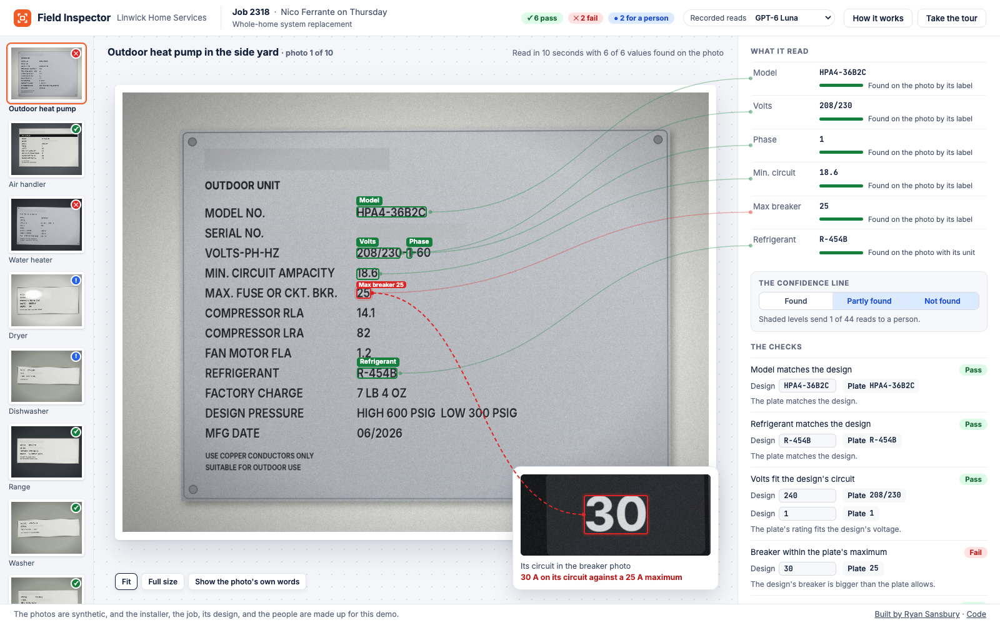
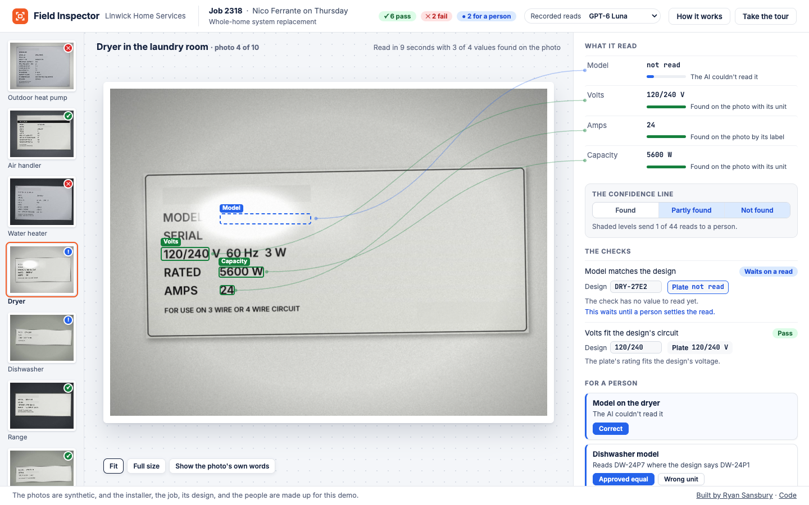
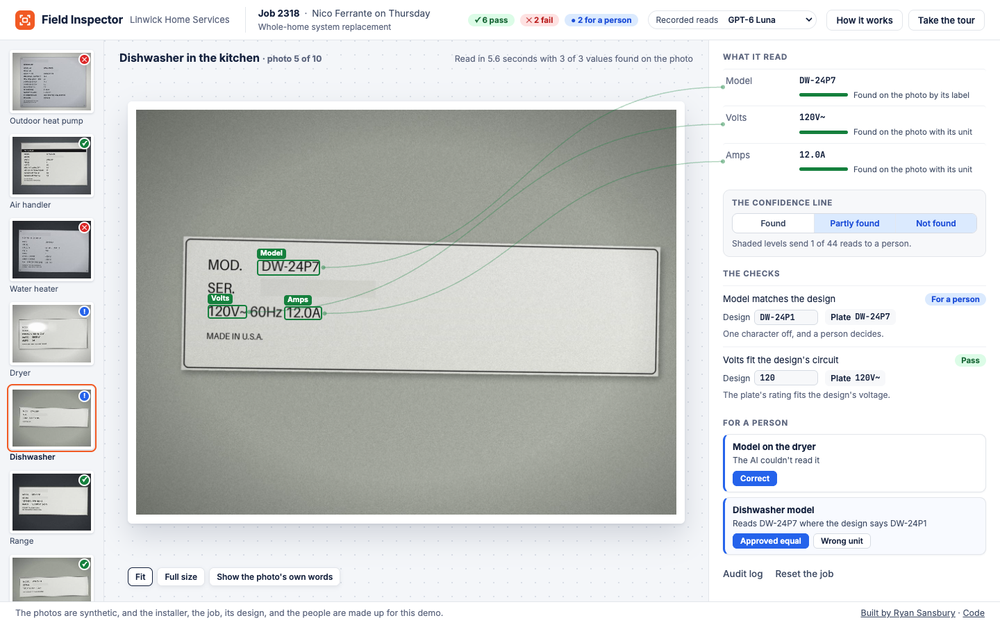
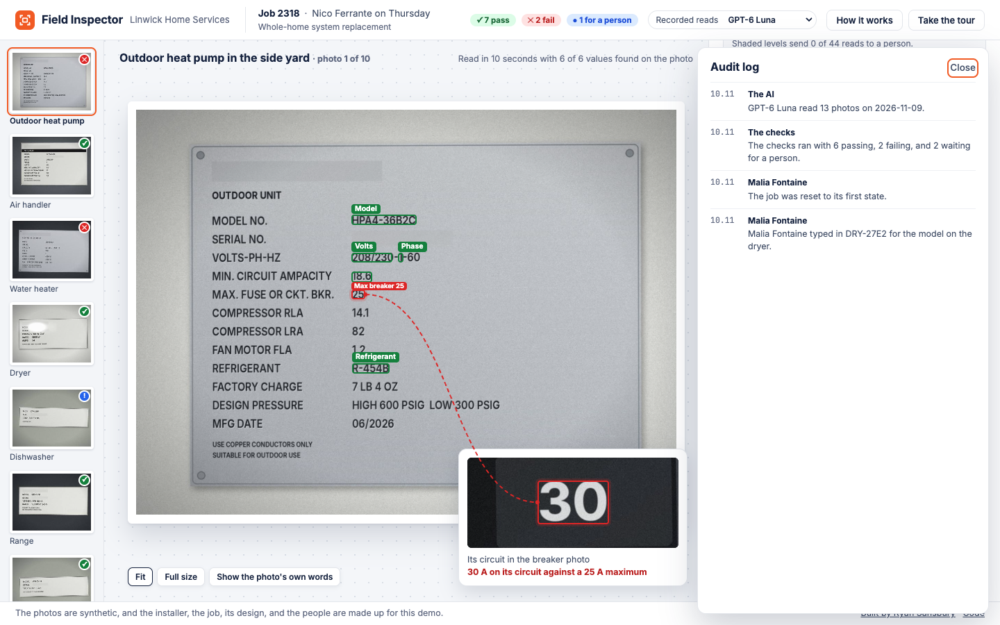
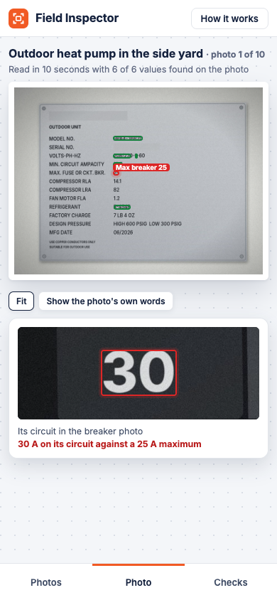

# Field Inspector

A technician's nameplate photos go in, AI reads every plate, the photo's own text confirms each value, code checks the values against the job's design and across photos, and anything uncertain or failing goes to a person. The live demo is at https://www.ryansansbury.com/field-inspector/ and it calls no model or service. The AI reads were recorded on the owner's machine, and the page replays them.

The photos are synthetic and were drawn and photographed by code to look like a technician's phone shots. The installer, the job, its design, and the people are made up.

## What's AI, what's code, and what's a person

- **AI** reads each plate into a fixed set of fields with the label it read each value under and a rough box. It never sees the design.
- **Code** finds the words on each photo with the Mac's own text recognition and confirms each read by the photo's own text near its label.
- **Code** runs the installer's rules on every value and across photos. The rules are kept as data in `config/rules.json` and run in Python for the scores and in JavaScript on the page.
- **A person** settles every read the photo couldn't confirm and decides whether a model one character off is an approved equal.

## The results

Every model got the same photos, and none of them saw the test photos until the prompt was frozen. The answer key comes from the same file that drew the plates and holds exactly what each photo shows. A wrong read past the line is one the photo's text seemed to confirm, and those are the dangerous ones.

| Model | Fields right on test | Wrong reads past the line | Wrong verdicts that skipped the person | Reads sent to a person | Cost per photo | Seconds per photo |
|---|---|---|---|---|---|---|
| Claude Sonnet 5.5 | 99% | 0 | 0 | 1% | $0.0146 | 6.1 |
| Claude Haiku 5.5 | 99% | 0 | 0 | 1% | $0.0008 | 4.7 |
| GPT-6 Luna | 99% | 0 | 0 | 1% | $0.0006 | 6.8 |

The page opens on GPT-6 Luna because it's the cheapest model that cleared every bar on the tuning photos.

## Screens

The dryer's model under glare as it waits for a person to type what the plate shows.

The dishwasher's model one character off the design as it waits for a person to decide.

The audit log with what the AI read, what the checks found, and each decision a person made.

The job on a phone.

## The photos

`generate/render.py` draws each plate from `generate/plates.json` and photographs it with an angle, glare, dim light, and grain. For real photos `owner/` holds the path that strips every photo, masks makers' names and serials, and has a person confirm each value before any model sees it. The build runs a privacy scan on every published photo and every file in the repo.

## Running it

Python 3.9 or newer and nothing else builds the page from the recordings with `python3 build.py`. The tests run with `python3 tests/run.py`, and Node runs the page's click-through and the parity checks between the Python and JavaScript rules. The owner's runs that read photos and call the models are in `owner/README.md`.

## What it can't do

It reads only what the photo shows, and a plate behind a bracket or under heavy glare goes to a person. It checks the installer's design rules and nothing else, and it isn't an inspection. It isn't production software, and the page can't read a new photo.

## License

The code is under PolyForm Noncommercial 1.0.0 in `LICENSE`. The fonts carry their own licenses in `site/fonts/`.
